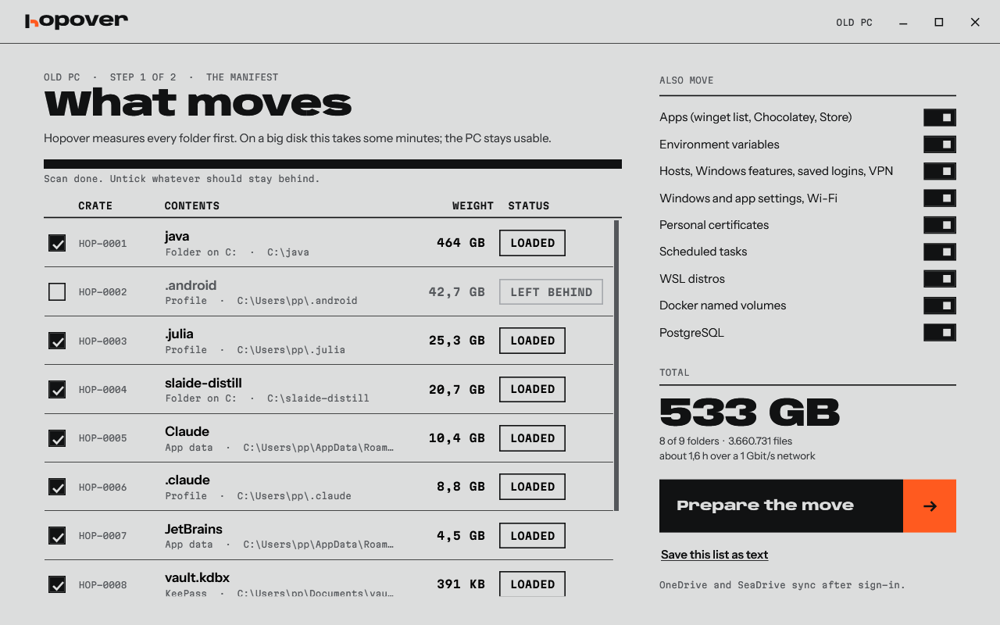

# Hopover

### Your old PC, on your new PC. Everything, not just your files.

Hopover moves your apps, settings, dev tools and files to a new Windows PC over the network.
Keep working while it runs. When it finishes, you just carry on.

**[⬇ Download Hopover.exe](https://github.com/madppiper/hopover/releases/latest/download/Hopover.exe)**

Free for personal use · Windows 10 and 11 · One file, nothing to install

## What it does

- 📦 **Brings your apps back:** reinstalls them through winget, Chocolatey and the Store, and copies the rest
- ⚙️ **Keeps your settings:** taskbar, wallpaper, Explorer, keyboard, Wi-Fi, and your app settings in the registry
- 🐧 **Moves your dev setup:** WSL, Docker volumes, PostgreSQL, env vars, PATH, SSH keys, git logins
- 📁 **Copies your files:** your profile, AppData, your folders and drives, big projects and all
- 🔄 **Lets you keep working:** one click fetches whatever changed on the old PC since
- 🛟 **Never throws anything away:** if two versions clash, both are kept
- 👀 **Shows you first:** a preview lists everything it will do, before it does it
- 🔒 **Stays between your PCs:** a pairing code and a direct, encrypted link, with no cloud in between

## How to use it

**On the old PC**

1. Start Hopover and click **This is the old PC**.
2. Untick anything you want to leave behind.
3. Click **Prepare the move** and note the code, like `3-alpha-bravo-cafe`.

**On the new PC**

4. Start Hopover and click **This is the new PC**.
5. Type the code and click **Connect**.
6. Click **Start the move**, and go get a coffee.

**When you are ready to switch**

7. Click **Catch up with the old PC** to fetch your latest changes.
8. Open the checklist. It lists the few things left to do, like signing in to your browser.

That's it. You can close Hopover at any time. Start it again and it picks up where it stopped.

## Good to know

- This is an early version. Keep a backup of anything you can't lose.
- Windows warns about the download because the exe is not signed. Click **More info**, then **Run anyway**.
- Docker images download again with your next `docker-compose up`.
- When you're done, delete `C:\hopover-store` on both PCs. It holds your Wi-Fi passwords and tokens.

---

Source available under the [PolyForm Noncommercial License](LICENSE.md). To build it yourself, run `.\build.ps1`.
