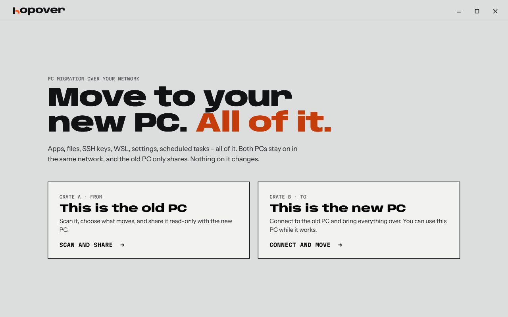
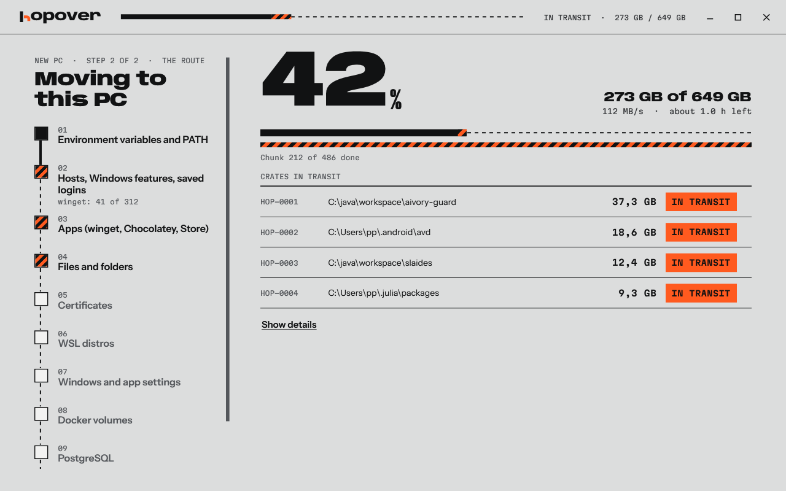
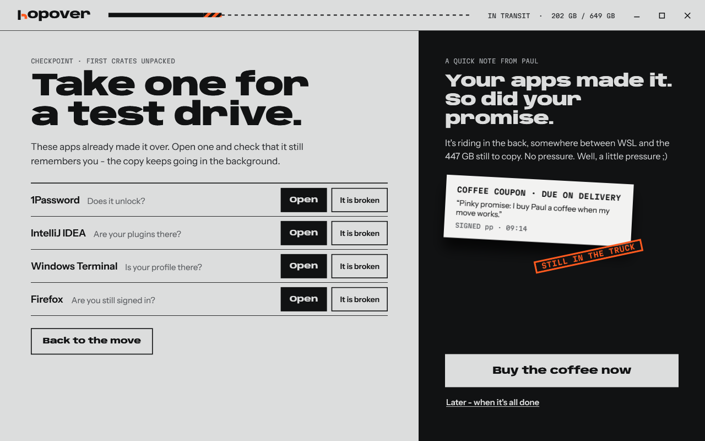
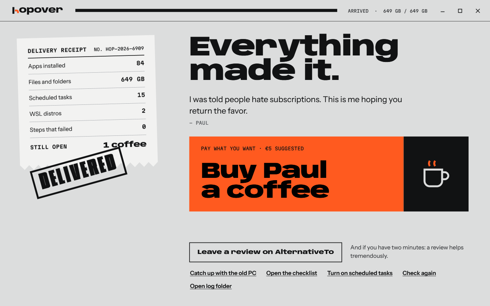

<h1 align="center">Windows to Windows Migration</h1>

  Hopover moves your whole PC to a new one - apps, settings, WSL, SSH keys, files. 
  Straight over your own network, while you keep working.

  

  Or with winget: <code>winget install Ilscipio.Hopover</code> 
  Coming soon: the package isn't in the winget catalog yet. Until then, use the download above.

  Free to move, pay on delivery. If it works, I want a <a href="https://buy.stripe.com/28E4gz8pMasZgLv1Snbsc00">coffee</a>, or a <a href="https://github.com/ilscipio/hopover/issues/new?title=My%20move%20with%20Hopover">review</a> and a <a href="https://github.com/ilscipio/hopover">star</a>. 
  If it fails, you owe me nothing. <a href="https://github.com/ilscipio/hopover/issues/new">Open a ticket</a> and I'll fix it :)

  Windows 10 and 11 - one file, nothing to install, no account - <a href="https://www.ilscipio.com/en/apps/hopover/">website and docs</a> - <a href="https://www.ilscipio.com/apps/hopover/">auf Deutsch</a>

&nbsp;

## What it does

- **Your apps** come back through winget, Chocolatey and the Store. No installer left? The program moves as a folder.
- **Your dev setup** moves too - WSL, Docker volumes, PostgreSQL, env vars, PATH, SSH keys, git logins, scheduled tasks.
- **Your Windows settings** come along, and I care a lot about those - taskbar, Start pins, wallpaper, theme, desktop layout, Explorer, sounds, night light, mouse, keyboard, languages, region, power plan, notifications, privacy, Wi-Fi, hosts file, Windows features.
- **Your app settings** arrive with all of AppData and the registry entries that go with it.
- **Your files** come over, big repos, junctions and symlinks included.
- **Your caches** too, if you want them. Gradle, npm, Playwright, IDE indexes. Each one is a tick in the list.

And the part I care about most: your old PC stays in use. Keep working during the move, then click **Catch up** to fetch what changed. If a file changed on both PCs, the new one keeps its version and the other waits for you in `C:\hopover-held`. Nothing gets thrown away.

Nervous? Switch on **Preview first** and you get a text file of everything Hopover would do. Your files go directly from PC to PC, encrypted. No cloud in between.

## How to move

**On your old PC:** start Hopover and click **This is the old PC**. The pairing code shows up right away. Untick what stays behind and click **Prepare the move**.

**On your new PC:** start Hopover, click **This is the new PC** and type the code. It waits until the old PC is ready. Click **Start the move** and go get a coffee.

**When you're ready to switch:** click **Catch up with the old PC** one last time and work through the short checklist. You sign in to your browser and your password manager, sign out of Windows once so the settings apply, and that's it.

You can close Hopover any time. It picks up where it stopped.

**Want it faster?** Plug one LAN cable straight from PC to PC and choose **Direct cable**. No router, no setup. Thunderbolt and USB4 cables work the same way if both PCs have those ports. A plain USB-C cable can't link two PCs - that's a hardware limit, sorry.

<table>
  <tr>
    <td width="50%"></td>
    <td width="50%"></td>
  </tr>
  <tr>
    <td align="center">Files, apps and WSL move side by side.</td>
    <td align="center">Halfway through, you can take your apps for a test drive.</td>
  </tr>
</table>

## Why I built this

I switch PCs every 2-3 years. And every time, setting up the new one costs me a day or two. Apps, SSH keys, WSL, env vars, that one scheduled task... and three weeks later I find out what I forgot.

I wanted it to be comfortable. That's really all there is to it. Start it on both PCs, do something else, sit down at the new one and carry on.

Turns out nothing did that for my setup. The paid tools move apps and files, but I found none that claims WSL, SSH keys or env vars. And when my new laptop arrived, I gave Microsoft's own restore a chance. My desktop looked different and my settings were gone. As expected. A PC only feels like yours when the taskbar, the keyboard and the hundred small things you tuned over the years are where you left them.

So I built it. It's young - my own move is its first big test - so keep a backup of anything you can't lose. If it breaks, tell me and I'll fix it.

## Good to know

- The exe isn't signed yet, so a browser download makes Windows warn you once. Click **More info**, then **Run anyway**. winget skips that warning.
- Docker images come back with your next pull. Browser profiles and OneDrive sync after you sign in.
- OneDrive, SeaDrive, Google Drive, Dropbox and other cloud folders stay out of the move. They sync by themselves after you sign in.
- Epic, GOG, EA and Ubisoft games download again.
- When you're done, click **Clean up** on both PCs, or say yes when you close Hopover. That removes its working folder with your Wi-Fi passwords and tokens. Your own files stay.

&nbsp;

  Did your move work? <a href="https://buy.stripe.com/28E4gz8pMasZgLv1Snbsc00">Buy me a coffee</a> - <a href="https://github.com/ilscipio/hopover/issues/new?title=My%20move%20with%20Hopover">leave a review</a> - <a href="https://github.com/ilscipio/hopover">star the repo</a>

Made by <a href="https://www.ilscipio.com/en/">ilscipio</a>. Source available under the <a href="LICENSE.md">PolyForm Noncommercial License</a>. Build it yourself with <code>.\build.ps1</code>.

