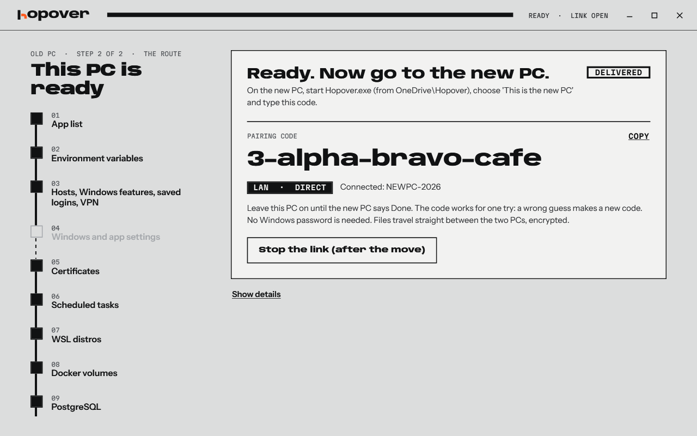

<h1 align="center">Free to move. Pay on delivery.</h1>

  <b>Your move costs nothing.</b> If it works, I want a <a href="https://buy.stripe.com/28E4gz8pMasZgLv1Snbsc00">☕ coffee</a>, or a <a href="https://github.com/madppiper/hopover/issues/new?title=My%20move%20with%20Hopover">✍️ review</a> and a <a href="https://github.com/madppiper/hopover">⭐ star</a>. 
  If it fails, you owe me nothing. <a href="https://github.com/madppiper/hopover/issues/new">Open a ticket</a> and I'll fix it.

  

Windows 10 and 11 · One file · Nothing to install · No account

## Move to your new PC. All of it.

A new PC should feel like a treat. Instead you lose a weekend: reinstalling apps, hunting for SSH keys, rebuilding WSL, fixing your PATH, and finding out three weeks later what you forgot.

**Hopover moves your whole PC to the new one.** Your apps, your settings, your dev setup and your files, straight over your network. You keep working while it runs. When it's done, you sit down at the new PC and carry on where you stopped.

> *Hi, Paul here. I built Hopover because no tool would move my whole dev PC: WSL, SSH keys, env vars and all. So go ahead and use it. Every feature, no trial, no locked buttons.*

## What's in the truck

- 📦 **Your apps.** Reinstalled through winget, Chocolatey and the Store, with Visual Studio workloads. No installer left? The program moves as a folder.
- 🐧 **Your dev setup.** WSL distros, Docker volumes, PostgreSQL, env vars and PATH, SSH keys, saved git logins, npm and pip tools, scheduled tasks.
- ⚙️ **Your Windows.** Taskbar, wallpaper, theme, Explorer, desktop layout, mouse, keyboard, languages, Wi-Fi, hosts file, Windows features.
- 🗝️ **Your app settings.** All of AppData and the registry entries that go with it, so your apps still know you.
- 📁 **Your files.** Your profile, your folders, your other drives. Half a terabyte of repos is no problem, and neither are junctions and symlinks.
- 🚀 **Your caches, if you want them.** Gradle, npm, uv, Playwright, IDE indexes. Tick them and skip the big download.

 Everything is on the manifest. Untick what stays behind.

## Why it's different

- 🔄 **Your old PC stays in use.** Work as usual during the move. One click on **Catch up** fetches what changed since.
- 🛟 **Nothing gets thrown away.** Changed on both PCs? Your new PC keeps its version, and the other one waits for you in `C:\hopover-held`.
- 👀 **Look before you leap.** **Preview first** writes everything Hopover would do to a text file. Read it, then decide.
- 🔒 **Your data stays yours.** A pairing code opens a direct, encrypted link between your two PCs. No cloud. No server ever sees a file.
- ⏯️ **Stop any time.** Close Hopover, shut the lid, come back tomorrow. It picks up where it stopped.
- 🧪 **Test drive included.** Halfway through, Hopover lets you open your apps and check that they still remember you.

<table>
  <tr>
    <td width="50%"></td>
    <td width="50%"></td>
  </tr>
  <tr>
    <td align="center">Files, apps and WSL move at the same time.</td>
    <td align="center">Take one for a test drive while the rest is in the truck.</td>
  </tr>
</table>

## How to move

**1. On your old PC**

[Download Hopover.exe](https://github.com/madppiper/hopover/releases/latest/download/Hopover.exe) and start it. Click **This is the old PC**, untick what stays behind, and click **Prepare the move**. You get a pairing code.

**2. On your new PC**

Start Hopover there too. Click **This is the new PC**, type the code, and click **Start the move**. Go get that coffee.

**3. When you're ready to switch**

Click **Catch up with the old PC** one last time. Work through the short checklist: sign in to your browser and your password manager. That's the part no tool can do for you.

 And now you know where the coffee comes in.

## The honest part

- **Hopover is young.** Keep a backup of anything you can't lose. If something breaks, [tell me](https://github.com/madppiper/hopover/issues/new): that's how it gets better.
- **Windows will warn you.** The exe isn't signed yet. Click **More info**, then **Run anyway**.
- **A few things stay behind.** Docker images come back with your next pull. Browser profiles and OneDrive sync after you sign in. Epic, GOG, EA and Ubisoft games download again.
- **Clean up afterwards.** Delete `C:\hopover-store` on both PCs. It holds your Wi-Fi passwords and tokens.

---

  <b>Did your move work?</b> <a href="https://buy.stripe.com/28E4gz8pMasZgLv1Snbsc00">☕ Buy me a coffee</a> · <a href="https://github.com/madppiper/hopover/issues/new?title=My%20move%20with%20Hopover">✍️ Leave a review</a> · <a href="https://github.com/madppiper/hopover">⭐ Star the repo</a>

Source available under the <a href="LICENSE.md">PolyForm Noncommercial License</a>. Build it yourself with <code>.\build.ps1</code>.

